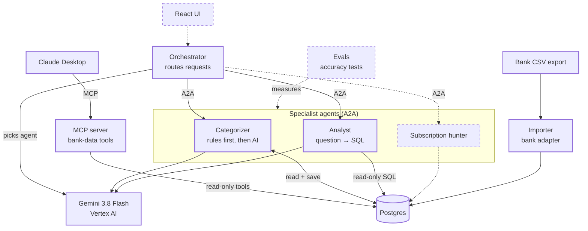

# Architecture

Koll is a personal-finance app built as a small multi-agent system. Specialist AI agents each do one job and talk to each other over the [A2A protocol](https://a2a-protocol.org/). An MCP server lets AI apps like Claude Desktop query the same data.

## System map

Solid boxes are built. Dashed boxes are planned.

## Components

| Component | Status | What it does | Code |
|---|---|---|---|
| Importer | Built | Converts bank CSV rows into a shared `Transaction` format and stores them. Re-importing a file creates no duplicates. | `packages/importer/` |
| Postgres | Built | Stores transactions and categories. Runs in Docker. Has a separate read-only login used by the analyst and the MCP server. | `docker-compose.yml`, `db/init/` |
| Shared types | Built | The `Transaction` type and category list every component uses. | `packages/shared/` |
| A2A helpers | Built | Builds messages and agent cards and starts agent servers, so each agent only contains its own logic. | `packages/a2a/` |
| Categorizer agent | Built | Applies user-defined rules first, sends the rest to the model, and saves the categories. Runs as its own A2A server. | `agents/categorizer/` |
| Orchestrator | Built | Discovers agents through their agent cards, lets the model choose which agent should handle a request (and explain why), then sends it over A2A. | `agents/orchestrator/` |
| Model provider | Built | Gemini via Vertex AI, behind an interface in each agent so the model can be swapped. | `provider.ts` / `model.ts` / `router.ts` |
| Analyst agent | Built | Turns a question in plain Swedish into SQL, runs it with read-only access, and explains the result. Returns the SQL so every answer can be checked. | `agents/analyst/` |
| MCP server | Built | Four read-only tools for MCP clients such as Claude Desktop: spending by category, transaction search, monthly totals and recurring payments. Fixed, parameterized SQL. | `packages/mcp-server/` |
| Subscription hunter | Planned | Finds recurring charges and price changes. | |
| Evals | Planned | An answer key and accuracy measurement for the categorizer and analyst. | |
| React UI | Planned | Chat interface with a live view of agents working. | |

## Request flows

**Import:** bank CSV → importer converts each row → Postgres.

**Categorize (working):**
1. The orchestrator fetches the categorizer's agent card from `/.well-known/agent-card.json`.
2. It sends an A2A message: "Kategorisera 10 transaktioner".
3. The categorizer reads uncategorized transactions from Postgres.
4. User rules run first (for example, a specific merchant always maps to one category).
5. The remaining transactions go to the model, which must answer in a fixed JSON schema.
6. Categories are saved, and the agent replies with a text summary and structured data.

**Ask a question (working):**
1. The orchestrator fetches every agent card and gives the model the list of agents and their skills.
2. The model picks the analyst and explains why. It can only answer with agents that exist, or "none".
3. The analyst has the model write one SQL query and runs it with five safety layers: SELECT only, one statement, a read-only transaction, time and row limits, and a database login that cannot write.
4. The model explains the numbers, and the reply includes the SQL and the rows.

**Claude via MCP (working):** Claude Desktop starts the MCP server, picks a tool such as `recurring_payments`, and the server runs that tool's fixed SQL with the read-only login. No model writes SQL on this path.

## Design decisions

- **Adapters for banks.** Only `swedbank.ts` knows the bank's CSV format. Adding a bank means adding one adapter.
- **Swappable model.** Agents call a provider interface, not a specific model SDK.
- **Rules before AI.** Deterministic user rules handle known merchants. The model only sees what the rules can't decide, which also lowers cost.
- **Never trust model output blindly.** Responses are forced into a JSON schema, and any category outside the allowed list falls back to "Övrigt".
- **Agents only know each other's address and agent card.** That keeps them independent and deployable as separate containers.
- **Routing by agent card, not by code.** The orchestrator has no hardcoded rules for which agent does what. A new agent with a clear agent card can be used without changing the orchestrator.
- **Defense in depth for AI-written SQL.** Code checks can have bugs, so the last layer is the database itself: the analyst connects with a login that has SELECT rights only.
- **Fixed SQL where possible.** The MCP tools use fixed, parameterized queries. Model-written SQL is only used where questions are too open for fixed tools.

## Deployment

- **Docker Compose:** one image for every agent. `docker compose up -d` starts Postgres and the agents; the orchestrator runs as a one-off container per request.
- **Kubernetes (local, kind):** the same image as Deployments with Services, a PersistentVolumeClaim for Postgres, readiness and liveness probes, and configuration from a ConfigMap and Secrets that are created from local files, never stored in git. See [`k8s/README.md`](k8s/README.md).
- **Later:** the same manifests on Google Kubernetes Engine, once the agents require authentication.
