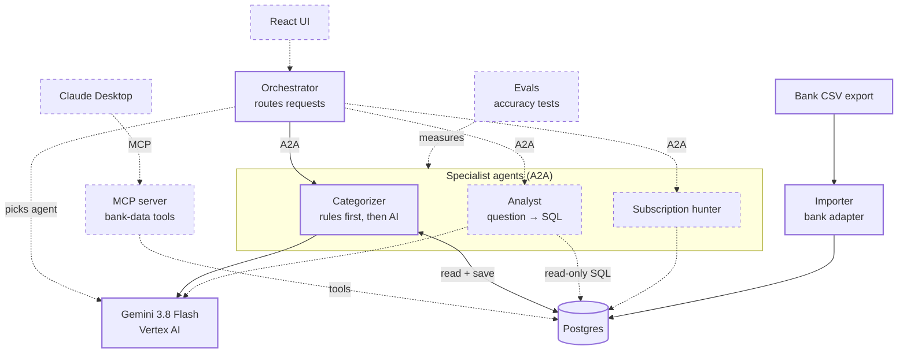

# Architecture

Koll is a personal-finance app built as a small multi-agent system. Specialist AI agents each do one job and talk to each other over the [A2A protocol](https://a2a-protocol.org/). An MCP server lets AI apps like Claude Desktop query the same data.

## System map

Solid boxes are built. Dashed boxes are planned.

## Components

| Component | Status | What it does | Code |
|---|---|---|---|
| Importer | Built | Converts bank CSV rows into a shared `Transaction` format and stores them. Re-importing a file creates no duplicates. | `packages/importer/` |
| Postgres | Built | Stores transactions and categories. Runs in Docker. | `docker-compose.yml` |
| Shared types | Built | The `Transaction` type every component uses. | `packages/shared/` |
| Categorizer agent | Built | Applies user-defined rules first, sends the rest to the model, and saves the categories. Runs as its own A2A server. | `agents/categorizer/` |
| Orchestrator | Built (basic) | Discovers agents through their agent cards and sends them tasks over A2A. | `agents/orchestrator/` |
| Model provider | Built | Gemini via Vertex AI, behind a provider interface so the model can be swapped. | `agents/categorizer/src/provider.ts` |
| Analyst agent | Planned | Turns a question in plain Swedish into SQL, runs it with read-only access, and explains the result. | |
| Orchestrator routing | Planned | Uses the model to read the agent cards and choose which agent handles a request. | |
| MCP server | Planned | Exposes bank-data tools to MCP clients such as Claude Desktop. | |
| Subscription hunter | Planned | Finds recurring charges and price changes. | |
| Evals | Planned | An answer key and accuracy measurement for the categorizer and analyst. | |
| React UI | Planned | Chat interface with a live view of agents working. | |

## Request flows

**Import:** bank CSV → importer converts each row → Postgres.

**Categorize (working):**
1. The orchestrator fetches the categorizer's agent card from `/.well-known/agent-card.json`.
2. It sends an A2A message: "Kategorisera 10 transaktioner".
3. The categorizer reads uncategorized transactions from Postgres.
4. User rules run first (for example, a specific merchant always maps to one category).
5. The remaining transactions go to the model, which must answer in a fixed JSON schema.
6. Categories are saved, and the agent replies with a text summary and structured data.

**Ask a question (planned):** UI → orchestrator picks the analyst → analyst has the model write SQL → runs it read-only → model explains the numbers → answer returns to the UI.

## Design decisions

- **Adapters for banks.** Only `swedbank.ts` knows the bank's CSV format. Adding a bank means adding one adapter.
- **Swappable model.** Agents call a provider interface, not a specific model SDK.
- **Rules before AI.** Deterministic user rules handle known merchants. The model only sees what the rules can't decide, which also lowers cost.
- **Never trust model output blindly.** Responses are forced into a JSON schema, and any category outside the allowed list falls back to "Övrigt".
- **Agents only know each other's address and agent card.** That keeps them independent and deployable as separate containers.

## Deployment

- **Now:** agents run locally with `tsx`, Postgres in Docker, the model on Google Cloud.
- **Next:** one container per agent, started together with Docker Compose.
- **Later:** the same containers on Kubernetes (GKE).
